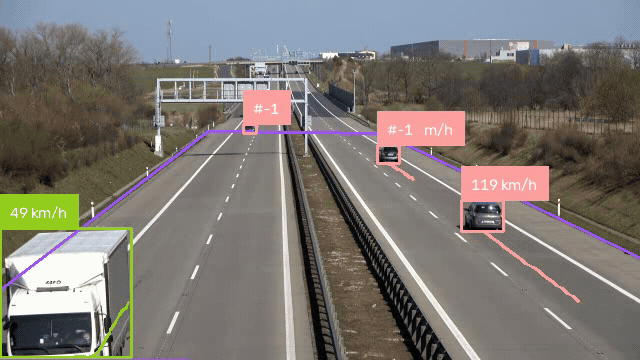
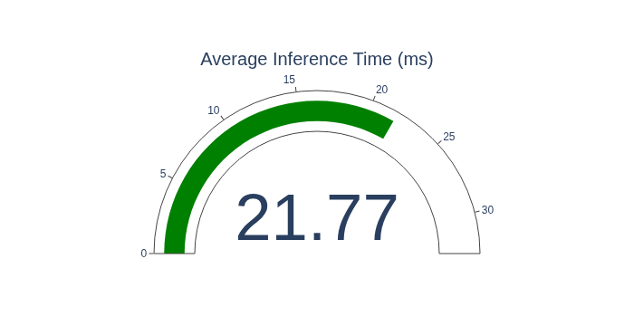

# YOLO26 Traffic Vision

A Voilà dashboard that runs **YOLO26n** on CPU: detect vehicles, keep identities with ByteTrack, and estimate speed in km/h from a calibrated road plane.

The point of the project is the hardware story. YOLO26 is built for end-to-end inference — an NMS-free one-to-one head and no Distribution Focal Loss — so the ONNX graph is smaller and cheaper to run than YOLO11. Ultralytics reports **YOLO26n at 38.9 ms** on CPU ONNX versus **56.1 ms** for YOLO11n (about **43% faster**), with a slight accuracy gain (40.9 vs 39.5 mAP on COCO). On a regular CPU, and especially on modest hardware, that gap is the difference between a live preview and a slideshow. Work that used to require powerful, expensive GPUs can now run on a regular CPU.

The app is a Jupyter notebook served as a dashboard. Inference uses the exported `yolo26n.onnx` graph; [Ultralytics](https://docs.ultralytics.com/models/yolo26/), [Supervision](https://supervision.roboflow.com/), [ByteTrack](https://github.com/ifzhang/ByteTrack) (via [`trackers`](https://github.com/roboflow/trackers)), and OpenCV handle detection, annotation, tracking, and the perspective transform. [Voilà](https://github.com/voila-dashboards/voila) hides the code cells and leaves the widgets.

<p align="center">
  
</p>

<p align="center"><em>Speed detection on CPU — YOLO26n ONNX, ByteTrack, perspective-warped km/h.</em></p>

#### Inference speed on my machine:

<p align="center">
  
</p>

## Local setup

Requires  Python 3.12+. [uv](https://docs.astral.sh/uv/) is used to manage dependencies.

Clone the repository:

```bash
git clone https://github.com/cian-ps/traffic-detection.git
cd traffic-detection
```

Install & run:

```bash
uv sync
uv run voila yolo26-traffic-vision.ipynb
```

Voilà then serves the notebook at <http://localhost:8866>.

Pick a task and click **Run**:

- **Detect** — frame-by-frame object detection
- **Track** — ByteTrack IDs across frames, limited to the road polygon
- **Speed Detection** — the same tracks, with speed in km/h from a homography onto a 25 m × 250 m road plane

Frames are resized to **640×360** before inference. Playback is paced to the source FPS; a Plotly gauge reports mean inference time in milliseconds when the clip finishes.

The video clip is Supervision's [`VideoAssets.VEHICLES` asset](https://media.roboflow.com/supervision/video-examples/vehicles.mp4) and is downloaded when the notebook is run.

If `yolo26n.onnx` is missing, the notebook downloads `yolo26n.pt` and exports ONNX (opset 12, 640², static shape, simplified, `nms=False` — YOLO26 does not need NMS). The `.pt` weights stay gitignored; the ONNX graph is the runtime artifact.

### Docker setup

The image already includes ffmpeg/OpenCV libs and binds Voilà on `0.0.0.0:8866`:

```bash
docker build -t traffic-detection .
docker run --rm -p 8866:8866 traffic-detection
```

Then open <http://localhost:8866>.

## How speed is estimated

Tracking alone gives pixel motion. Speed needs metres. A quadrilateral `SOURCE` (in the 640×360 frame) is warped to a rectangle `TARGET` of **25 m × 250 m** — the assumed width of the carriageway and the length of road visible in that ROI. Each tracked box’s bottom-center is projected with `cv2.getPerspectiveTransform`. A one-second deque of those Y coordinates yields

```text
speed_km/h = abs(y_now - y_oldest) / (n_samples / fps) * 3.6
```

once at least half a second of history exists. The polygon is a camera-specific calibration, not a universal speed gun: change the clip or the camera and you must re-draw `SOURCE` / `TARGET`.

## License

This project is licensed under the [GNU Affero General Public License v3.0](LICENSE) (**AGPL-3.0**).

That is required for the combined work: it imports [Ultralytics YOLO](https://github.com/ultralytics/ultralytics) (AGPL-3.0) and uses YOLO26 pretrained weights. Ultralytics treats those weights, ONNX exports (`yolo26n.pt` / `yolo26n.onnx`), and applications that ship them as AGPL-covered.

Direct dependencies remain under their own licenses. They are not relicensed by this repo:

| Package | License |
| --- | --- |
| [ultralytics](https://github.com/ultralytics/ultralytics) (and `ultralytics-thop`) | AGPL-3.0 |
| [supervision](https://github.com/roboflow/supervision) | MIT |
| [trackers](https://github.com/roboflow/trackers) | Apache-2.0 |
| [onnx](https://github.com/onnx/onnx) | Apache-2.0 |
| [onnxruntime](https://github.com/microsoft/onnxruntime) | MIT |
| [onnxslim](https://github.com/inisis/OnnxSlim) | MIT |
| [plotly](https://github.com/plotly/plotly.py) | MIT |
| [anywidget](https://github.com/manzt/anywidget) | MIT |
| [lap](https://github.com/gatagat/lap) | BSD-2-Clause |
| [jupyter](https://github.com/jupyter/jupyter) / [voila](https://github.com/voila-dashboards/voila) | BSD-3-Clause |

Full texts ship with those packages (and in `uv.lock` / the Docker image). Transitive dependencies keep their upstream licenses.
